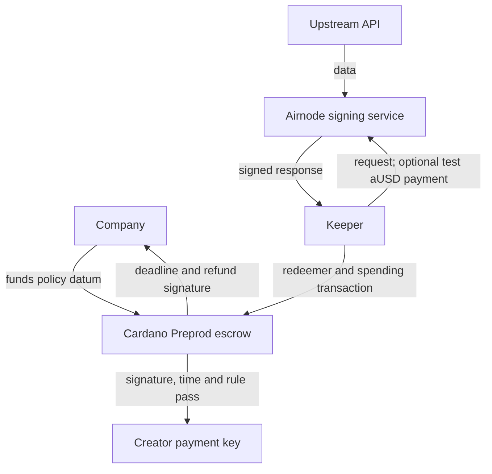

# CreatorPay oracle architecture — Cardano Preprod / Base Sepolia only

Reviewed 31 October 2026 against the supplied repository, rebuilt Aiken bytecode, automated tests, and public Preprod ledger data. This is a code review, not an external audit certification.

## Verdict and architecture

The current signed-data integration is a valid **pull oracle integration**. API3 supplies oracle infrastructure; AirnodeHub provides discovery and signed API responses; the selected Airnode key acts as the oracle authority for this escrow. No separate Cardano oracle contract, oracle UTxO, bridge, or reference input is needed for the implemented rule.



Base Sepolia is used for optional API-access payment, not as a source of Cardano consensus. Neither the validator nor its datum verifies a Base transaction, state root, or bridge message. A free signed feed follows exactly the same Cardano proof path. The offline signature transports an attestation; it is **not a blockchain bridge**.

## Ten precise answers

1. API3 is an oracle infrastructure provider. Airnode is a signed-data API/attestation service, and AirnodeHub supplies discovery. In this application the signer is also the trusted oracle source. These descriptions concern different layers and are compatible.
2. Yes: external facts determine on-chain settlement, with cryptographic authentication by the validator. The keeper is a courier, not the oracle verification authority.
3. API3's conventional data-feed integration reads values maintained in destination-chain contracts. CreatorPay instead carries a signed API response in each spending transaction. It does not read an API3 EVM feed contract.
4. No additional oracle contract/UTxO is necessary. The escrow validator already verifies the proof and the policy datum already specifies trust and rules.
5. Yes. The release redeemer carries timestamp, numeric byte strings, and compact signature. The validator reconstructs the signed text from these bytes and immutable datum fragments, then verifies it itself.
6. No Base–Cardano communication is required. A test aUSD receipt is not an input to `pay_on_proof`.
7. Cardano independently executes `verify_ecdsa_signature` and Keccak hashing. Off-chain `checkAgainst` is only an optimization; it does not verify signatures and cannot authorize a payout.
8. A passing proof authenticates the pinned key's signature over the exact request hash, timestamp and reconstructed response bytes. It does not prove real engagement, honest measurement, copyright ownership, campaign quality, or identity of the legal operator.
9. The funder chooses the datum (normally re-derived by the buyer from a local registered vector). Registration obtains/reconstructs a public key from a response and checks the endpoint's advertised Airnode address. This authenticates consistency with that key; the endpoint/listing-to-real-provider association remains an off-chain trust decision. The response's self-declared `airnode` is not a replacement for a pinned key.
10. The company and creator must inspect the funded datum; both trust the chosen signing service and upstream facts. Keeper availability affects timely release and paid-query cost, but cannot redirect a valid ADA release. The facilitator can delay/refuse broadcast, but cannot change signed payment contents. Cardano enforces spending, not service availability. A refund needs the refund key holder and fees after the deadline; it is not automatic.

## Code-level verification

`aiken/airnode_spike/lib/airnode.ak:17` computes:

```
inner = keccak256(request_hash || timestamp_as_32_byte_unsigned_big_endian || data)
message = keccak256(0x19 || "Ethereum Signed Message:\n32" || inner)
verify_ecdsa_signature(pinned_compressed_pubkey, message, signature_r_s)
```

The expected key is 33-byte compressed secp256k1; the signature is 64-byte r||s. Airnode's 65th recovery byte is unnecessary when verifying against an explicit public key, rather than recovering one. On-chain `request_hash` comes from the policy, not from a response-selected field. A response signature for a different request therefore fails even if an attacker relabels its JSON envelope.

`lib/engine.ak:154` rebuilds the response using prefix, slot strings, separators and suffix. Re-serializing parsed JSON would alter signed bytes; this code preserves them. `release_ok` checks slot count and selected range; the rule parses nonnegative decimal strings exactly, with a fixed scale. Unsupported negative/scientific notation fails closed. Off-chain floating-point hints can disagree with exact on-chain arithmetic; they are not authoritative.

The transaction must have finite bounds. Signature time in seconds is converted to milliseconds. It must be at/after `settle_after`, no later than the validity lower bound, and remain within `max_age` through the upper bound. The upper bound must not exceed the deadline. Where configured, an observed-time slot must be no later than signing +1000 ms and no older than `obs_max_age` at signing. These are different freshness checks: a newly signed response can contain old observations. Nodary enables both; the registered creator-post policy does not have an observation slot.

| Property | Enforced / remaining dependency |
|---|---|
| Cryptographic authenticity | Pinned key verifies exact bytes on Cardano |
| Data correctness | Signer and upstream trusted; bought/fake likes not detected |
| Data freshness | Signature window enforced; observation age only when configured; historical rainfall deliberately describes old dates |
| Source identity | Key pinned; real-world operator attribution established outside the contract |
| Payment enforcement | One current-validator input; one output at beneficiary key receives max(payout, locked ADA) |
| Availability | API, keeper, funding wallet, facilitator/provider and network must respond before deadline |

## Reference inputs versus reference scripts

A reference input (CIP-31) reads an existing UTxO without consuming it. A pushed oracle feed would need an authenticated source UTxO, update authority and publisher. Simply reading an arbitrary datum is not authentication. CreatorPay already authenticates the attached proof, so adding such a feed introduces deployment and liveness work without solving a demonstrated gap.

A reference script (CIP-33) could store the same validator once and reduce repeated script bytes in releases. It does not replace signature verification or authenticate a provider. It requires an initial transaction, locked minimum ADA, and a stable unspent reference. Net fee savings were not measured. No reference-script transaction was submitted; retain attached scripts for this demonstration.

A key registry might support future revocation, but changes policy semantics and introduces governance. It is not needed to explain or run the current testnet project. Existing policies have no key rotation: if their signer becomes unavailable, their refund path remains.

## English answer for judges

“API3 provides the signed external data, so it is functioning as our oracle. We use a pull model: a keeper carries the response into a Cardano transaction. Our Aiken validator independently rebuilds the message, verifies its secp256k1 signature against the key pinned in the escrow, checks the request, time window and threshold, and enforces the ADA payout. Base Sepolia only pays for API access; no cross-chain messaging is involved. We do not need an oracle reference UTxO because the proof authenticates itself against the pinned key. We still trust that key's operator and upstream data, and depend on data and keeper availability.”

## Primary documentation consulted

- [Airnode attestation specification](https://airnodehub-docs.api3.org/airnode/attestation): request canonicalization, digest and trusted-address discovery.
- [Airnode overview](https://airnodehub-docs.api3.org/airnode/): signed API wrapper and optional paid requests.
- [API3 documentation](https://docs.api3.org/) and [data feed overview](https://docs.api3.org/dapps/): conventional feed integration.
- [CIP-31](https://cips.cardano.org/cip/CIP-0031), [CIP-33](https://cips.cardano.org/cip/CIP-0033).

The architectural verdict is an inference from the actual code and successful ledger spends, not a claim of official API3/Cardano integration certification.
