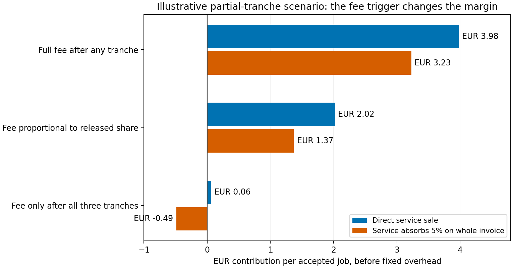

# Overnight pass 1: define what earns the fee before choosing the price

Checked **31 October 2026**. This extends [the initial report](REPORT.md); it does not change the application or replace its historical validation. Results below are bounded evidence and explicitly synthetic calculations.

**Recommendation:** the requesting brand/agency should cover agreed monitoring work even when a creator misses the target. However, distinguish a fixed service fee from a refundable data budget, and define success per tranche before quoting a success fee. The service cannot transfer the cost of its own undelivered monitoring to the buyer merely by calling it an unsuccessful campaign.

## One previously unknown fee now has a primary source

The current [Masumi transaction-fee documentation](https://www.masumi.network/dev/masumi/core-concepts/transaction-fees) states a **5% network fee on the selling price**, in the active stablecoin, separately from Cardano's ADA transaction fees. This supersedes the first report's statement that the note's 5% number lacked first-party verification. It does not establish the actual fee treatment of this untested adapter, who bears it in a particular offer, whether refunds recover it, or a seller's net receipt. No payment was made.

If the entire €9+€10 service invoice goes through Masumi and we absorb that fee, the original illustrative all-or-none base contribution falls from **€3.80 to €3.05/job**. If only the bonus is sold there, do not apply 5% to a separate off-platform base fee. If the buyer reimburses it, show the surcharge distinctly; that raises buyer cost rather than improving the underlying service value. Never apply the keeper's service fee to creator principal simply because the keeper is hired through Masumi.

The free Twitter Airnode GET document now directly confirms its published expected address and `tweetsByIds` price/payment metadata. The operation advertises `0.01` and a USD label, but the actual declared payment rail is **Base Sepolia, aUSD**. This remains a test-token quote, not proof of a commercially available one-cent signed response. The document also says deleted tweets stop resolving; that is provider documentation, not a new deletion experiment. [Public self-description](https://airnode-twitterapi.fly.dev/), [official consumer documentation](https://airnodehub-docs.api3.org/api-consumers/), [catalogue](https://airnodehub.api3.org/llms.txt). No POST operation, token spend or signature was requested.

For comparison, [TwitterAPI.io's own pricing](https://twitterapi.io/pricing) quotes **US$0.15/1,000 returned tweets**, with **US$0.00015 minimum/request**; its [endpoint table](https://twitterapi.io/pricing/details) includes tweet details by ID. Those direct upstream responses are not automatically signed by the key the Cardano policy trusts. Raw-price savings do not make them a drop-in replacement for the authenticated settlement input. A possible future design uses inexpensive raw monitoring to trigger a final authenticated observation, but freshness, false negatives, rights, reliability and actual signed-data commercial pricing still need confirmation. It is not built or tested here.

[LunarCrush's pricing](https://lunarcrush.com/pricing) advertises $90/$300/$900 monthly Light/Medium/Heavy plans and corresponding request limits of10/100/500 per minute and2k/20k/100k daily, shared across API/MCP/CLI. Commercial use is within plan limits. Those are subscription/capacity alternatives, not a proven substitute for arbitrary creator-post coverage or this project's signed source. No subscription or API key was created. Provider quotas and coverage require admission controls rather than assuming unlimited monitoring.

## Partial tranches change both revenue and the meaning of success

The original model simplified a three-tranche job to all-or-none. The new [calculator](tranche-economics.py), [inputs](tranche-inputs.json) and [36-row results](tranche-economics.csv) enumerate distributions across0/1/2/3 releases, three fee definitions, and direct/Masumi-absorbed/buyer-surcharge allocations.

Consider an illustrative distribution: **40% no releases, 20% one tranche, 20% two, 20% all three**. At least one tranche succeeds in60% of jobs, but all three succeed in only20%; expected paid principal is40% of the total. With a €9 base and a maximum €10 bonus:

| Explicit success-fee promise | Expected service revenue/job | Direct contribution | Contribution if service absorbs5% on entire invoice |
|---|---:|---:|---:|
| Full€10 after any tranche releases | €15.00 | €3.98 | €3.23 |
| Proportional€10 × released fraction | €13.00 | €2.02 | €1.37 |
| €10 only after all three release | €11.00 | €0.06 | **−€0.49** |

All EUR costs and outcome probabilities are assumptions. Expected variable operating cost here is€10.52, reflecting1.2 expected releases at€0.30 each plus€10.16 of assumed all-job costs. Collection is2%+€0.20. The platform rate is documented, but applying it to the whole proposed invoice and choosing who absorbs it are scenario choices. Fixed overhead, acquisition and unquoted mainnet/provider costs remain outside contribution.

Thus “60% successful” alone cannot price the service. The definition can move the same job from positive to negative contribution. A customer might reasonably regard one delivery tranche plus two failed retention/bonus tranches as partial performance, not full success. Agree the fee trigger before funding. A proportional per-tranche fee is a useful test, but requires separate billing today; it is not an output currently deducted by the validator.

The same model keeps a hypothetical €500 creator budget separate from service revenue. For this distribution it pays€200 expected creator principal;1.8 remaining tranches require assumed refunds. Funding, refund costs and returned principal reconcile independently of our margin. The current public offer still fixes5tADA, so this €500 case is a commercial scenario, not a claim that variable fiat-sized payouts are implemented.

## What “pay regardless of success” should mean

| Outcome | Proposed commercial treatment | What still needs a product/terms decision |
|---|---|---|
| Target missed; monitoring delivered as agreed | Earn the fixed/capped monitoring fee; no unreleased-tranche success fee. Return eligible creator escrow after deadline, less disclosed refund costs where applicable. | What counts as delivered monitoring, source failure and completed evidence packet? |
| Target met in one or more agreed windows | Earn monitoring fee and the pre-agreed per-tranche/full-job success fee; creator gets principal under its own terms. | Submission versus confirmed payout; actual collection and reconciliation. |
| Our service stops or fails to perform agreed checks | Refund/credit undelivered service; absorb our failure cost. Do not label our outage a creator's failure. | Incident evidence, service-credit cap, data-provider exceptions and promised recovery. No SLA built. |
| Provider unavailable | Follow the outage/refund rule agreed in advance; disclose gaps. A signed stale value is not fresh observation evidence. | Is the job paused, extended, rescheduled, human-reviewed or refunded? |
| Buyer supplied invalid terms/payee before admission | Refuse before funding; charge only explicitly agreed setup already performed, if any. | A clear preview and acceptance boundary; no new arbitrary fee implied. |
| Buyer prepays a metered data reserve | Charge actual agreed usage and return the unused balance; it is not all earned revenue on receipt. | Durable per-job accounting/restart behavior and how collection costs are allocated. |

There are two distinct price designs:

- **Data-inclusive fixed€9 monitoring fee:** covers specified work/capacity, with an agreed maximum number of looks. Fewer looks do not automatically mean a refund of the fixed fee, if that is the accepted service promise.
- **Separate service fee plus refundable data reserve:** an illustrative alternative is€8.37 fixed service plus€0.63 reserved for60 monitoring+3 setup looks at an assumed€0.01 each. At14 monitoring looks+3 setup, actual data use is€0.17 and€0.46 returns. At all60 looks, use is€0.63 and none returns. This **replaces** the data-inclusive€9 design; it is not€9 plus another charge. Collection fees on pass-through funds still need costing. [Three reconciled examples](monitoring-reserve-examples.csv).

My earlier chat's “unused monitoring budget is returned” means the **unspent reserve**, not an automatic pro-rata refund of an explicitly agreed fixed fee. Neither billing design is implemented. Using one clearly defined fixed/capped package may be easier for an initial agency pilot; refundable metering requires more accounting work and has little value if the amounts are tiny compared with support.

## The actual pure scheduler passed into252 synthetic scenarios

[monitoring-simulation.mjs](monitoring-simulation.mjs) imports only the existing import-free `polling.ts`, using Node22.14.0's experimental type stripping. It does not import service/wallet/environment modules or contact providers. It compares the current planner with authored fixed-five-minute, one-final-look and fast-five-second schedules over20/60/1,440-minute usable windows,6/60/300-look caps and seven synthetic count/outage paths. [CSV](monitoring-simulation.csv), [source hash and assumptions](monitoring-simulation-receipt.json).

For a **60-minute usable window and60-look cap**:

| Synthetic path | Current adaptive planner | Fixed five minutes | One final-window observation | Fast five seconds |
|---|---|---|---|---|
| Never meets target |14 looks, no detection |12 looks, no detection |1 look, no detection |60 looks; cap exhausted by4m55s |
| Steady rise, first crosses at36min |8 looks; detects at36min |9 looks; detects at40min |1 look; detects at59min |Cap exhausted before crossing |
| Crosses persistently at58m30s |14 looks; detects at59min |12 looks; last at55min, misses |1 look at59min, detects |Cap exhausted before crossing |
| Short45-second burst at24min |Misses |Misses |Misses |Cap already exhausted |

This is **not** a success-rate estimate. The paths were deliberately chosen illustrations, not sampled engagement histories. A cheaper end-only rule changes the customer promise if they expected “ever crosses.” Fast booth mode is inappropriate for a long promise under the same small budget. Adaptive monitoring did better on the steady example, but even spent more than fixed-five-minute monitoring on the flat example. There is no demonstrated universally cheaper/better schedule.

The simulation never actually fetches after its stop. Some returned next-check times extend past stop, consistent with the previously triaged schedule issue; no new post-stop spending defect is claimed. Failed attempts are conservatively counted in a hypothetical maximum aUSD spend, with one-minute simulator retries; actual provider billing on errors and the full watcher failure loop were not reproduced. Chain confirmation, release cooldown, source-sharing concurrency and provider cache/refresh semantics are excluded. A single-post simulation cannot justify an agency-wide settlement SLA.

## Validation and remaining overnight work

[validate-overnight.py](validate-overnight.py) independently recomputed all36 tranche rows by summing individual outcome states, reconciled the three reserves, and checked252 simulation rows for attempt caps, pre-stop observation times, cost/attempt reconciliation and selected independent fixed-schedule expectations. The imported source SHA-256 matches. These checks passed; no previous application suite or blockchain evaluation was rerun.

Remaining decision-relevant work is agency cohort capacity and operational fee sensitivity: inspect the single-release/cooldown behavior, derive bounded throughput/queue scenarios, quantify synchronized-deadline risk, and test whether support/monitoring caps can make the customer price credible. Do not expand into new accounts, live-chain performance tests or broad feature work. Signer rotation, actual paid-service compatibility, customer willingness to pay and commercial signed-data quotes still require external evidence; a large synthetic grid cannot validate them.

Pass timing: **02:50:01–03:01:09 CET**, 31 October 2026, followed by Git/PR publication. Balance at the latter check: **89.6120345 shared Codex credits**, against the continuation's64.3228345 stopping threshold. This is not exact job-local consumption or euros. The hourly continuation remains active until useful scope is complete or the owner's time/balance limit is reached.
