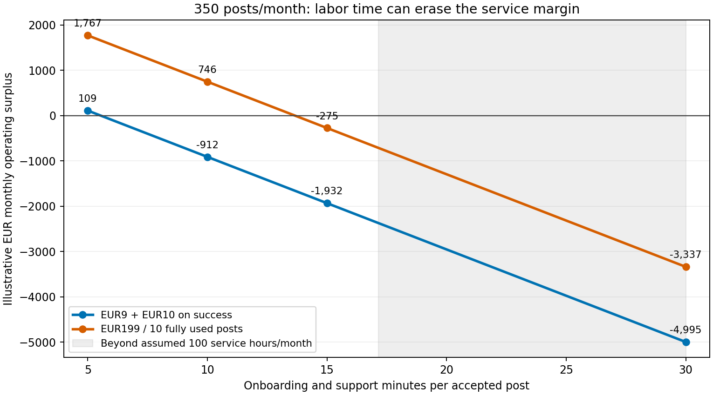

# Overnight pass 2: admit work by deadline capacity, not only by available data balance

Checked **31 October 2026**, starting **03:49:06 CET**. This pass inspected the existing watcher and computed explicit queue/support scenarios. It did not run the service, contact a paid API, evaluate a transaction or measure production throughput.

**Decision:** keep the pilot small, reserve release capacity before accepting a monitoring job, and avoid promising that every creator in an agency cohort will settle within the single-demo payout time. The monthly labor model alone misses a second constraint: many jobs can need the same keeper near the same deadline. Also, the current watcher shares a paid look **within a cycle**, not a cached proof across every later release.

## Source behavior and the main-branch change

Remote main advanced to `1cb0272d9d31f74ee55cd307e52824c65d9432eb` during the night. The only change from the reviewed application base is TRUST.md clarifying that the refund party authorizes a refund; the validator does not constrain its destination. No relevant code changed. This review fetched that ref without merging/rebasing or changing the application's checkout. The initial report and current main's clarification should be read together.

The reviewed [watcher source](https://github.com/luk-huebner/tum-hack-2026/blob/1cb0272d9d31f74ee55cd307e52824c65d9432eb/cardano/src/autorelease.ts) shows:

- `203–250`: group due policies by source, fetch a new response per due source, check all policies in that group, and put results in a cycle-local array.
- `270–276`: sort ready policies by deadline and select **one** policy to release.
- `299–301`: wait for confirmation, then set a **45-second cooldown**. `317–330` adds the loop sleep; the default interval at `97` is20 seconds.
- `226`: normally do not fetch the same paid source twice within60 seconds.
- `184,198–200`: policies too close to deadline are excluded; cooldown suppresses data collection before another release.

The [validator](https://github.com/luk-huebner/tum-hack-2026/blob/1cb0272d9d31f74ee55cd307e52824c65d9432eb/aiken/airnode_spike/validators/pay_on_proof.ak) deliberately permits one of its policy inputs per release. Reference scripts could affect transaction fees but would not by themselves remove this watcher/validator serialization.

On the **normal no-error branch**,45 seconds of cooldown after confirmation is a lower bound on spacing before the next cycle's fresh work. With idealized zero-latency20-second ticks the next eligible tick is60 seconds later. This60 seconds is **not a universal physical lower bound**: actual RPC work changes tick phase, and confirmation/build/source work adds delay. The modeled60/90-second spacings are scenarios, not measured throughput or an SLA.

Likewise, one paid look can check several same-post policies in one cycle, but only one is submitted. A later cycle fetches a new response; there is no persistent signed-response cache in the inspected path. For simultaneously ready tranches, “one post shares a look” does not imply “one bought response settles every tranche.” This is a cost behavior of the current design, not a new security finding.

## A synchronized cohort can run out of time or data budget

[cohort-capacity.py](cohort-capacity.py), [inputs](cohort-inputs.json) and [144-row CSV](cohort-capacity.csv) model already-met conditions, distinct paid sources per post, a stable equal-deadline ordering, no errors and no new arrivals. Every cycle rechecks remaining sources and selects one release. “Usable window” ends at keeper stop, itself three minutes before the contractual deadline. The first submission is optimistically at time zero. All token costs below remain **test aUSD**, never euros/USD.

| Explicit synthetic cohort | Result under those assumptions |
|---|---|
|10 posts ×3 simultaneously due tranches;60-minute usable window;90-second submission spacing;600 pooled looks |All30 submissions fit; last submission at43.5 minutes;165 paid source looks in the modeled source order. This is not confirmation of a customer cohort. |
|25 posts ×3 due tranches;60-minute window;90-second spacing;1,500 looks |40 of75 submissions fit the time window. The other35 remain; equal-deadline ordering determines who receives partial performance. |
|10 posts ×3 due tranches;60-minute window;60-second spacing;30-look global budget |Budget buys only three modeled release cycles, each checking ten sources; three submissions complete one post in the chosen order. Twenty-seven policies remain. |
|100 posts ×3 due tranches;180-minute window;60-second spacing;6,000 looks |Budget binds at68 modeled submissions;232 remain. The full cohort would require15,150 looks in this ordering and299 minutes between first/last submissions at that spacing. |

With N distinct source-posts and T ready tranches each, this specified ordering consumes `T × N(N+1)/2` looks to finish when time/budget are unlimited. For10×3 that is165 looks; for100×3 it is15,150. That quadratic pattern is **conditional on this synthetic all-ready/source-order scenario**, not a forecast of all campaigns. One-then-two-tranche campaign waves are also included in the grid. Partial final source sweeps still allow the first paid source to release, so the independent check accounts for that boundary.

A future just-in-time proof cache could reduce repeated source purchases where the exact request/key and policy windows allow reuse. One look/post is an optimistic comparator for short, same-post tranche waves; it is not implemented and would be invalid once proof age/window constraints expire. A second experiment is selecting the next eligible deadline/source before buying data from every source. Both must preserve fairness, source health and proof freshness, and need ordinary offline integration tests before a real pilot. They do not require replacing the verified signature mechanism.

**Admission rule to prototype:** before accepting a job, reserve its source-look budget and a feasible release slot for each tranche window, including retry/confirmation headroom. Reject, widen or stagger windows when it cannot fit. A larger global cap alone cannot fix a deadline queue, and running more processes without wallet/input coordination is not a demonstrated fix. The current global process cap is not a per-agency reservation system.

## Support time decides whether the agency price can fund operations

[96 support scenarios](support-sensitivity.csv) hold the first report's all-or-none60% outcome case fixed, with€1.95 nonlabor cost/job,€35/hour allocated onboarding/support,100 service hours/month and€3,000 additional fixed overhead. They compare direct billing and absorbing the documented5% Masumi fee on the entire service invoice. These are assumptions; this grid is not jointly calibrated to the queue outcomes above.

At15 minutes/job and a5% absorbed network fee:

| Price model | Contribution/job | Monthly surplus at350 posts | At400 posts /100 service hours |
|---|---:|---:|---:|
|€9 monitoring +€10 on success |€3.05 |−€1,932.50 |−€1,780.00 |
|€199 for ten fully used posts |€7.787 |−€274.55 |€114.80 |

The initial report's€73.70 surplus at350 subscribed jobs was a **direct-billing, zero-platform-share** scenario, not a claim for Masumi distribution. Absorbing the now-verified fee flips that case negative. It must not be added to the direct route without reason, nor ignored when our whole service price actually incurs it.

Reducing onboarding/support from15 to10 minutes gives the subscription case **€746.28** illustrative monthly surplus at350 posts, before unquoted costs, taxes and deviations. It does not prove an agency will buy the subscription, that ten minutes is achievable, or that a cohort can settle within its windows. The€9+€10 case is still negative at that350-post volume. The labor target therefore matters more than optimizing a few test ADA decimals.

The shaded region exceeds the assumed100 service hours for350 posts; plotted surplus there is arithmetic, not feasible staffing capacity. All scenarios include unsuccessful accepted jobs. Existing agency SaaS may already remove much of the example customer's manual work, while crypto onboarding adds work. A paid pilot must measure **net** customer time/value and our actual support time before a subscription price is defensible.

## Verification and next decision

[validate-capacity.py](validate-capacity.py) independently checked all144 queue rows using a cumulative-source-look formula, including partial last sweeps, rather than importing the simulation. It recomputed all96 support rows as whole-month revenue/fees/labor costs, reconciled hours and checked break-even/capacity fields. Checks passed. The chart was rendered and visually inspected. An initial authoring assertion expected192 support rows; the correct4×6×2×2 count is96 and was fixed before delivery. No application test suite was rerun.

The useful offline decision is now narrower: sell only an explicitly capped monitoring/evidence service whose accepted load fits both the data budget and tranche windows; earn the monitoring fee for delivered work, and define success separately per tranche. The next valuable evidence is an agency time diary/acceptance test and a provider's commercial signed-data terms, followed by authorized preprod integration/security work. More invented traffic or price grids would not establish demand, mainnet cost or profitability.

Pass2 useful-work end: **03:56:53 CET**, recorded duration7m47s, followed by publication. Shared balance at that check72.3648945 credits; no exact job-cost or euro attribution. [Morning handoff](MORNING_HANDOFF.md) consolidates the completed review.
