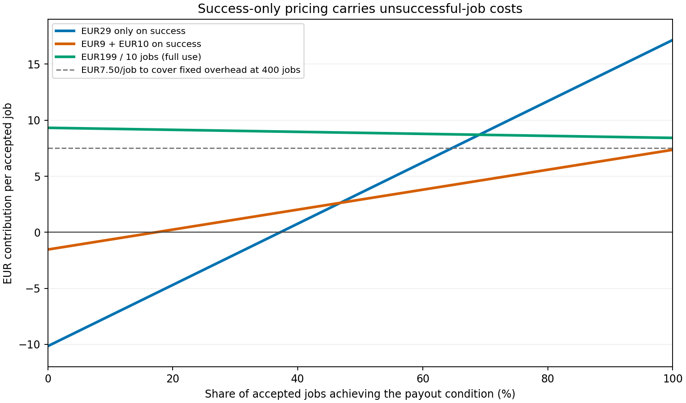

# Pay-on-Proof has a credible testnet mechanism; sell a measured agency pilot before claiming a profitable service

## Executive answer

**Keep the verifier and conditional-settlement demo. Test an agency monitoring and evidence service, with an optional delivery-plus-performance payout. Do not claim a profitable company yet.** The current code implements much of the recorded mentor response: pinned signed data, request binding, timing checks, a corrected one-input release rule, named creator payees, tranche templates, a judge interface, and a bounded keeper. Several supposed weaknesses would be false accusations. Authenticity is deliberately narrower than genuine engagement; Masumi is optional for Cardano qualification; reference inputs are an architectural question, not a missing mandatory feature. [Repository evidence](../../../TRUST.md), [official Cardano requirements](https://hackathon.tum-blockchain.com/prizes#cardano), checked 31 October 2026.

**The immediate confirmed submission gap is visibility:** the authenticated GitHub metadata returned `private` during this review. Published rules require a public repository. Change visibility only after the owner's secret/publication decision; this review does not change it. The final video and Devfolio submission are unverified, rather than proven missing. The published deadline is **31 October, 15:00 Munich/Berlin time**. [Submission rules](https://hackathon.tum-blockchain.com/prizes#how-to-submit), [official schedule](https://hackathon.tum-blockchain.com/), checked 31 October 2026. The recorded slides were not retrieved; the four supplied team notes were read as team records.

**There is a plausible service, but no demonstrated demand or defensible profit.** The first buyer is a brand or agency that already has creator relationships and needs agreed evidence, monitoring and payout reconciliation. The prototype does not replace discovery, negotiation, creative review, tax/payment administration, disputes or relationship management. SERVICE.md admits no customer conversations and testnet subsidy. More volume improves fixed-cost absorption only after contribution is positive; it magnifies negative contribution otherwise. [SERVICE.md](../../../SERVICE.md), [ITERATIONS.md](../../../ITERATIONS.md), observed at base `82d88dc63341e8498b4728e3bd2f3996aa560a5e`.

The illustrative model gives **€10.70 variable cost per creator-post job**, including unsuccessful jobs, at a 60% success probability. A **€9 monitoring fee + €10 on success** yields **€3.80 contribution**, before €3,000 assumed monthly fixed overhead. Covering that overhead needs 790 jobs, exceeding the assumed 400-job labor capacity. **€199/month for ten fully used jobs** yields €8.78/job contribution, but roughly 35 such agencies only just cover the same overhead; the example customer's net labor value is only €17.50/job. These are scenario assumptions, not prices observed on mainnet, forecasts or willingness-to-pay evidence. [Inputs](model-inputs.json), [calculator](model.py), [results](scenario-results.csv).

## What evidence is being compared

This report reviews the unchanged main commit above, not a merge of the overnight PRs. “Met” means the reviewed code and named historical receipts support the scoped requirement; it does not mean this review reran the flow. “Partial” means a supported part works but a relevant element remains open. “Unverified” means evidence is insufficient; “absent” requires positive evidence of absence/mismatch; “ambiguous” requires clarification. The machine-readable [requirements ledger](requirements-ledger.csv) carries source, implementation, receipt, status, impact, smallest action and effort.

Four authorized local notes were read: `03_TRACK_REQUIREMENTS.md`, `05_FEEDBACK_AND_RESPONSE.md`, `07_MENTOR_AND_PITCH_SHEET.md`, `08_PRICING_THINKING.md`, in the supplied team-pack directory. The mentor recording itself, opening PDF, Cardano PDF and original API3 workshop slides were **not** read. Notes about a mentor's preferences do not become published eligibility rules. The “first API3 verifier on Cardano” claim and any investor/residency outcome remain unproved.

Primary web pages were checked on **31 October 2026**. Some browser-text fetches failed or showed only the default BSV tab; direct HTTPS reads of the Masumi pages, API3 challenge and the organizer page's embedded track data succeeded. No paid operation was called. [Evidence ledger](evidence-ledger.json) records authority and limitations.

### Requirements and receipts

| Requirement or mentor concern | Actual implementation and receipt | Status and implication |
|---|---|---|
| Public repo, setup README, short video, description, deadline | GitHub metadata: private. README exists; PR9 found a root/service setup mismatch. PR10 is a draft, not a submitted entry; final video not inspected. | **Absent public visibility; other delivery items unverified.** Resolve before 15:00. [Organizer](https://hackathon.tum-blockchain.com/prizes#how-to-submit), [PR9](https://github.com/luk-huebner/tum-hack-2026/pull/9), [PR10](https://github.com/luk-huebner/tum-hack-2026/pull/10). |
| Cardano: useful paid service; one paid preprod job/request, transaction and end-to-end demo/business case | x402 paid keeper and script escrow exist. PROOFS records payment `51188ed4…` and release `1678080a…`; current-version escrow flows are recorded later. | **Met at repository-receipt level; submission packaging unverified.** x402 qualifies without real Masumi. [Official track](https://hackathon.tum-blockchain.com/prizes#cardano), [receipts](../../../PROOFS.md). |
| API3: verified data essential; deployed contract; signer/request/time checks and duplicate-execution protection | `engine.release_ok` verifies pinned key/hash, signed text and validity bounds. Validator spends one policy and pays its beneficiary. Current deployment and releases recorded. | **Met in reviewed design and historical evidence.** A display-only integration is not what this code implements. [Challenge](https://api3dao.github.io/airnodehub-hackathon/), [engine](../../../aiken/airnode_spike/lib/engine.ak), [validator](../../../aiken/airnode_spike/validators/pay_on_proof.ak). |
| API3: one accepted control and four rejected tamper cases; judges can submit responses | Judge page, HTTP routes and script exist. PROOFS records controls and rejections; PR5 observed six expected bench outcomes. | **Met in recorded scoped checks; fresh demo still unverified here.** Evaluation rejections are not failed on-chain transactions. [Challenge](https://api3dao.github.io/airnodehub-hackathon/), [judge guide](../../../cardano/JUDGES.md), [PR5](https://github.com/luk-huebner/tum-hack-2026/pull/5). |
| API3 explanation: users relying on data; forgery consequence; desired unavailable data | PR10 provides all three answers, including limited indexed YouTube/Instagram observations. | **Partial delivery:** reuse draft; do not claim catalogue-wide absence from limited probes. [Organizer track](https://hackathon.tum-blockchain.com/prizes#api3), [PR10](https://github.com/luk-huebner/tum-hack-2026/pull/10), [PR11](https://github.com/luk-huebner/tum-hack-2026/pull/11). |
| API3 real-use-case weight and autonomous bonus | Official challenge exposes 40/100 use case; up to +10, maximum 110, for repeated autonomous core workflow. Keeper logs show waiting, backoff and releases; real model-driven MCP host is not demonstrated. | **Partial bonus case; no score predicted.** AI/model use is not necessary to the core deterministic keeper. An MCP client alone does not establish the bonus. [Challenge](https://api3dao.github.io/airnodehub-hackathon/), [PR8](https://github.com/luk-huebner/tum-hack-2026/pull/8). |
| Mentor: distinguish authenticity, condition and work completion; explain backend tradeoff | TRUST makes this distinction and retains data-provider truth, liveness and dispute assumptions. | **Met in documentation.** Explain it in the pitch; avoid “proves legitimate engagement.” [TRUST](../../../TRUST.md). |
| Mentor: adapt under challenge | ITERATIONS records concrete changes; current validator fixes the documented first-version double-satisfaction flaw. | **Met as a documented iteration story.** Neither an independent audit nor proof of historical priority. [ITERATIONS](../../../ITERATIONS.md), [AUDIT](../../../AUDIT.md). |
| Mentor: make it a service with an economic stance | SERVICE separates open contract, paid keeper and future premium tooling. It also says losses last until volume, without contribution evidence. | **Partial.** Replace the volume rationale with an explicit bounded pilot/subsidy or positive-contribution plan. [SERVICE](../../../SERVICE.md). |
| Mentor: bring users to Masumi, rather than pitch a superior rival | MIP-003 adapter and stand-in checks exist. No real registration, payment or seller receipt. | **Unverified real integration, optional eligibility route.** PR2 is blocked preflight; do not present it as completed Masumi commerce. [MASUMI](../../../cardano/MASUMI.md), [PR2](https://github.com/luk-huebner/tum-hack-2026/pull/2). |
| Mentor: reference inputs; authoritative signer and rotation | Pull proof is already sufficient to verify the response. Policy pins a key; no registry/rotation mechanism is demonstrated. | **Ambiguous mentor intent; future design choice.** No published mandate for reference inputs found. Key provenance still needs a clear operational answer. [Source architecture below](#the-current-pull-design-is-adequate-for-the-demo). |

All externally sourced requirements in this matrix were checked on 31 October 2026. The sponsor's current [Masumi submission checklist](https://www.masumi.network/tum-hackathon/submission) calls payment evidence optional for its walkthrough and points back to TUM rules. That does **not** waive the organizer's paid-preprod qualification rule. The [Masumi agent guide](https://www.masumi.network/tum-hackathon/agent) now recommends a pinned CLI/worker route and an execution-first setup; it is not evidence this project's older adapter is incompatible. A real compatibility run remains needed only if that route is claimed.

The official API3 page also makes observation time distinct from signing time and requires appropriate checks. The recorded 40% and 110-point figures agree with that page. No contradiction requiring invented scoring weights was found. [API3 challenge](https://api3dao.github.io/airnodehub-hackathon/), checked 31 October 2026.

### Version and prior-work boundaries matter

PROOFS explicitly distinguishes the original `a9e4420c…` validator from current `58fb7eef…`. Earlier releases prove the old version did those things, not the current validator's safety. Later current-version releases, the current source and PR7's bounded artifact/CI checks are the relevant support. README's blanket “no observation-time check” is stale: `engine.ak:193–208, 235–247` implements an **optional** signed observation-age check, and `escrow.ts:128–129` wires it from source configuration. It does not manufacture an observation timestamp for tweet data. [PROOFS](../../../PROOFS.md), [PR7](https://github.com/luk-huebner/tum-hack-2026/pull/7).

Existing work reused, without rerunning tests or merging branches:

| PR | What it establishes within its own scope | What this review does not infer |
|---|---|---|
| [1](https://github.com/luk-huebner/tum-hack-2026/pull/1) | Agency pilot hypotheses and acceptance cases | Customer demand or completed pilot |
| [2](https://github.com/luk-huebner/tum-hack-2026/pull/2) | Real-Masumi preflight blocked; no receipt | Mandatory Masumi disqualification |
| [3](https://github.com/luk-huebner/tum-hack-2026/pull/3) | Judge rehearsal, artifact/log checks | Independent confirmation of every transaction |
| [4](https://github.com/luk-huebner/tum-hack-2026/pull/4) | Scoped history scanners and limits | Secret-free certificate; no sensitive values copied here |
| [5](https://github.com/luk-huebner/tum-hack-2026/pull/5) | Bench observations and partial accessibility | Exact-byte API validation or complete accessibility |
| [6](https://github.com/luk-huebner/tum-hack-2026/pull/6) | 69 offline tests: 60 pass, 9 fail; triage narrows two priority defects | Nine production bugs, duplicate charges or spending after stop |
| [7](https://github.com/luk-huebner/tum-hack-2026/pull/7) | Partial claim coverage; current artifact and historical CI checks | Complete claims/transaction audit |
| [8](https://github.com/luk-huebner/tum-hack-2026/pull/8) | Partial no-key MCP protocol test | Real model-driven host or successful payment tools |
| [9](https://github.com/luk-huebner/tum-hack-2026/pull/9) | Newcomer setup problems and rewrite proposal | Source README already corrected |
| [10](https://github.com/luk-huebner/tum-hack-2026/pull/10) | Receipt-backed Devfolio draft | Published entry or final video |
| [11](https://github.com/luk-huebner/tum-hack-2026/pull/11) | Fifteen dry price probes | Paid signed responses, field stability or working new integrations |

PR6's `C-TRIAGE.md` was read from `origin/night/c` (`63ba2507…`); PR1 and PR10 branch documents were also inspected. Other rows rely on authenticated PR descriptions and preserve their limitations. No D/red-team work was recreated.

## Ranked grounded gaps and smallest useful responses

Effort below is planning judgment for a maintainer familiar with the code, not a delivery commitment.

| Priority | Grounded gap and evidence | Smallest action / acceptance evidence | Effort and consequence |
|---|---|---|---|
| 1 — eligibility | **Repository private**, contrary to published public-repo rule. Video/Devfolio completion unknown. | Owner handles visibility after reviewing PR4's limits; use PR10 to finish entry; verify a logged-out reader can read setup and receipt links. Confirm video ≤2.5 minutes and submitted track fields. | 15–45 min if no sensitive-publication issue; deadline-critical. No visibility change authorized in this review. |
| 2 — demo credibility | Version chronology and stale README freshness wording can cause the team to overclaim or use old receipts. [PR7](https://github.com/luk-huebner/tum-hack-2026/pull/7); README/TRUST/PROOFS differ. | Select one current-validator payment/release, current control + four tamper outcomes and refund; put version/date next to each. Adopt PR9 setup wording. State submitted vs confirmed accurately (`service.ts:153–164`). | 20–40 min editorial/demo rehearsal; no new feature needed. Missing fresh receipt alone is not a code defect. |
| 3 — observed timing defect | PR6 P3 shows `planNext` returning 120,000 ms with only 60,001 ms before keeper stop; current caller stores that schedule. It can miss an affordable final observation. | Return no next check if infeasible, or schedule a feasible last check respecting budget/floor. Existing boundary regression must pass. | 30–90 min plus focused offline checks. No proof of paid calls or transactions after stop. Relevant to time-limited creator promises. |
| 4 — conditional on claiming Masumi | PR6 M1: rejected duplicate request can clear another request's nonce lock; three-request interleaving makes **two injected MPS payment requests**. `masumi-agent.ts:135–158, 211–212`. | Only the request that acquired the lock may release it. Preserve sequential retry and conflicting-input behavior; then real-service compatibility/receipt work with authorized resources. | 30–90 min for lock fix; real MPS work separate and resource-dependent. No proof of duplicate invoice payment/charge. x402 demo can proceed without it. |
| 5 — commercial decision | No customer validation; economic promise not tied to monitoring caps, support time, failed jobs or actual mainnet/data quotes. SERVICE/notes acknowledge subsidy. | Instrument a supervised testnet pilot; set acceptance budget and service completion definition. Record costs for every enrolled post, not only successes. Test willingness to pay against current workflow. | 1–2 days preparation plus an agreed campaign window; highest company decision value. |
| 6 — payout/product scope | Public offer fixes 5 tADA (`escrow.ts:18,127,165`); tranches multiply escrows. Validator pays all locked lovelace to the beneficiary (`pay_on_proof.ak:74–79`). No fee-splitting output. | Pilot fixed test amounts; quote service fee separately. Before real campaigns, design variable payout offers/client checks and separate billing. Only change validator if a genuinely needed payout/fee rule requires it. | 0.5–2 days for offer/billing prototype; security review separately. Do not deduct our fee from creator principal using today's release rule. |
| 7 — data/business fit | Signature time does not establish tweet observation time, genuine likes, marketing ROI or continuous retention. Actual deletion and independent creator wallet untested; unlike simulated deletion. | Contractual measurement wording: “provider-reported count at permitted signed snapshots.” Obtain source refresh/observation semantics and deletion/edit behavior. Use human approval for quality; offer delivery plus bonus. | One focused provider/mentor clarification and supervised pilot cases. Not proof the existing signature verifier is broken. |

Do not add a second oracle, key registry, veto window, stablecoin escrow or hosted AI model before the deadline merely to fill this list. For ADA-only test templates, the documented native-token limitation is outside the flow; do not advertise a general multi-asset production escrow. A textual disclosure check is useful but does not prove legal compliance. An external audit and operational review are prerequisites to a mainnet recommendation, not evidence that a testnet submission fails. [AUDIT](../../../AUDIT.md), [CREATOR_PAY](../../../cardano/CREATOR_PAY.md).

### The current pull design is adequate for the demo

The [API3 starter](https://github.com/api3dao/airnodehub-hackathon-starter) describes fetching an off-chain signed response and delivering it to a contract; it does not require a Cardano-to-EVM bridge transaction. Here the keeper carries the signed bytes into the spending transaction, and Cardano verifies the signature itself. Current `proof.ts:180–190` attaches the script. This matches the required verify-then-act pattern. API3 data **payment** is separately on Base Sepolia; that does not move the creator payout off Cardano. [AirnodeHub catalogue](https://airnodehub.api3.org/llms.txt), checked 31 October 2026.

| Choice | What it would change | Decision for this project |
|---|---|---|
| **Current pull proof** | Per-request signed response in release; request and signer pinned in each policy. Off-chain sharing already lets escrows on one post reuse a look. | Keep. Suits post-specific, sparse settlement. Each current release still spends one policy. |
| **Pushed oracle datum read through a reference input** | Publisher writes a shared on-chain observation; many consumers read it without spending that publication UTxO. Adds update transactions, publication liveness, provenance and version rules. | Optional if many settlements need the same data at similar times. Does not inherently fix stale upstream observations. Benchmark at actual reuse density. [CIP-31](https://cips.cardano.org/cip/CIP-0031), checked 31 October 2026. |
| **Trusted signer registry through a reference input** | Consumer can consult an authenticated key/version policy. Requires governance, rollback/revocation and rules for already-funded policies. | Future operational design. Prevent an administrator from silently substituting a signer that can release existing funds; consider pinning a key/version and allowing only revocation with refund. No current registry is claimed. [CIP-31](https://cips.cardano.org/cip/CIP-0031). |
| **Reference script** | Script stored in a UTxO, referenced instead of repeatedly attached; data still arrives as a pull proof. | Optional fee experiment. Current fee rules also charge for reference scripts; no measured net saving is claimed. Include publication/min-ADA and expected reuse before deciding. [CIP-33](https://cips.cardano.org/cip/CIP-0033), [current fee explanation](https://developers.cardano.org/docs/learn/core-concepts/fees/), checked 31 October 2026. |

**Signer authenticity and provenance:** pinned-key verification answers “did this key sign these bytes?” It does not independently answer “is this the authorized TwitterAPI/API3 key?” `offerPolicy` takes the key and request from the registered vector; registration checks a signed response, but this review did not establish an independently authenticated catalogue-to-key record for every source. That is an **unverified onboarding assurance**, not proof a wrong key is pinned. The official challenge identifies the Airnode GET document as the expected-address source; Nodary operates its own Airnode, whereas the other described challenge listings use an API3-operated Airnode over third-party APIs. [API3 challenge](https://api3dao.github.io/airnodehub-hackathon/), checked 31 October 2026. Ask for an authoritative publication/rotation process. Save listing URL, request/projection, expected key, verification date and policy version before funding. Never accept the expected key merely because an incoming response supplies it.

**Freshness semantics:** current code requires signing after `settle_after`, before the transaction lower bound, and a transaction upper bound no later than signing + maximum age or policy deadline. Optional `observation_fresh` checks observation-to-signature age with one-second timestamp slack. The total possible observation-to-execution age therefore includes both windows. A late signature on an old upstream count is still possible when the source supplies no observation time. Snapshot retention proves presence at allowed measurements, not uninterrupted presence between them. Public proof reuse across separately funded policies with the same request/key is intentional; consuming each UTxO prevents that policy paying twice. [engine.ak:191–249](../../../aiken/airnode_spike/lib/engine.ak), [TRUST](../../../TRUST.md).

## Who pays each cost

The wallet submitting a transaction and the party economically paying for it need not be the same. Agency sponsorship/reimbursement can hide crypto handling commercially, but **that bundling is not implemented** and has treasury, authorization, FX and operational costs. A buyer does not inherently have to hold ADA forever merely because the prototype uses a buyer wallet.

| Event / cost | Current wallet or direct payer | Current economic burden / future choice |
|---|---|---|
| Creator payout principal | Buyer funds 5 tADA per policy through x402; escrow later pays named beneficiary | Buyer's campaign spend; creator's compensation. **Neither our revenue nor our operating cost.** |
| Funding transaction | Buyer x402 client builds/signs funding; facilitator broadcasts | Buyer inputs cover principal and network fee in documented flow. Could be agency-sponsored or reimbursed; no current sponsored-funding product claimed. `escrow-client.ts:58–63,109–130`; PROOFS funding receipts. |
| Release per tranche | Operator/keeper transaction; full locked lovelace must reach beneficiary | Keeper supplies fee/collateral outside payout. Commercially include in watch fee or pass through once. Base scenario absorbs release fees. `proof.ts:180–190`, `service.ts:16–17,128,153`; validator payout rule. |
| Expired refund | Refund-party wallet signs and builds | Refund party bears fee; documented refund returned locked amount minus fee. It need not have a separate fee balance if transaction construction can fund the fee from that input. `refund.ts:43–53`; PROOFS refund `1057e1d9…`. No creator clawback after release. |
| Paid data looks | Service's data-payment account; aUSD test token on Base Sepolia | Operator subsidizes today; future buyer budget, bundled allowance or metering. Include all unsuccessful jobs and retries; one source observation may serve multiple escrows. Source freshness/quotas limit safe reuse. |
| Intake and source setup | Tool operator buys intake and registration checks | Per-post setup cost, not zero. Creator guide estimates one intake plus two registration looks. Existing stable source metadata may be reused only when request/post and policy semantics match. |
| Retries / provider errors | Keeper performs more reads/evaluations; submitted transactions may consume fees | Distinguish a free rejected evaluation, paid data retry, already-settled request and newly submitted transaction. Do not multiply every failure by a chain fee. Lost responses require reconciliation before retrying. |
| Hosting, RPC/API quotas, scheduler/state, uptime | Operator pays subscriptions/compute or consumes free quotas | Still economic cost at scale. Dedicated instances, alerting, durable budgets, per-tenant allocation and support need measured limits; free-tier availability is not a permanent cost quote. |
| Registration/platform distribution | Real Masumi registration/payment not completed here | Setup wallet/min-ADA and any service/platform fee need current official quote and receipt. The note's “5% Masumi network fee” is **unverified**; not used as a fact. Model 0% direct sales plus hypothetical 5%/10% sensitivity. |
| Treasury/FX/working capital | Operator manages data tokens and fee wallet; buyer prefunds escrow | Include conversion spreads, topups, locked capital and human work. Test-token balances imply no euro exchange rate. Current data rails do not demonstrate ADA-native data payments. |
| Support, exceptions, onboarding, finance | Team and agency staff | Labor remains even when outcome fails. Scope refund and dispute assistance; do not sell an uptime or fraud guarantee on a demo receipt. |
| Payment collection / failed campaigns | Our service invoice payer; creator principal is separate | Charge monitor/base on accepted jobs regardless of outcome if agreed; success fee only on defined event. Collection fee, refunds of service fees and unpaid invoices require terms. Scenarios exclude principal collection fees and add only service collection. |

This map is a static reading of the specified code plus historical receipts, not a new payment experiment. **0.31 tADA is not €0.31; 0.01 aUSD is not US$0.01.** The official catalogue calls aUSD a test dollar. Cardano fees depend on transaction size, execution and any reference script; actual mainnet costs require protocol parameters and the actual built transaction. No ADA/fiat rate or mainnet fee quote was obtained, and no conversion is made here. [AirnodeHub](https://airnodehub.api3.org/llms.txt), [Cardano fees](https://developers.cardano.org/docs/learn/core-concepts/fees/), checked 31 October 2026.

**The billing promise needs one definition.** The x402 `/api/keep` handler calls submission and returns “Submitted; it lands in the next block” (`service.ts:153–164`); SERVICE's “paid only when it releases” should specify submission versus confirmed settlement and recovery. The Masumi adapter can submit a “not released by deadline” job result as completed (`masumi-agent.ts:250–255` and MASUMI.md); that is not automatically a success-only release fee. Neither observation establishes an actual erroneous charge. Keep hired-job completion, payout-condition success, transaction confirmation and creator principal separate in a commercial contract.

## Economics: a cap and labor discipline matter more than a nominal chain fee

One modeled job is **one creator post with three tranches**. Each post gets setup and monitoring; the three tranches share observations. Expected releases are `3q`, with q the probability all tranches succeed in this deliberately simplified model. Actual partial tranche outcomes must be measured. Every accepted job incurs the stated looks/labor, including failures. There is no claimed early-success saving. Funding and refund fees are passed through at cost outside service revenue/cost; release fees are absorbed. There is no double counting of principal or fee reimbursements.

All euro amounts below are assumptions; no test-token amount has been converted into euros. [Complete inputs and exclusions](model-inputs.json).

| Assumption per creator-post job | Pessimistic | Base | Optimistic |
|---|---:|---:|---:|
| Outcome success probability q | 35% | 60% | 85% |
| Monitoring looks, plus setup looks | 288 + 3 | 60 + 3 | 15 + 3 |
| Assumed €/look | 0.050 | 0.010 | 0.005 |
| Tranches; assumed €/release | 3; 0.30 | 3; 0.30 | 3; 0.15 |
| Extra submitted tx allowance/job | 0.30 | 0.10 | 0.05 |
| Allocated onboarding + support minutes | 15 + 30 | 5 + 10 | 2 + 3 |
| Loaded €/labor hour | 45 | 35 | 30 |
| Variable hosting + treasury/FX | €1.50 + €0.75 | €0.50 + €0.25 | €0.25 + €0.05 |
| **Expected variable cost** | **€50.96** | **€10.70** | **€3.28** |
| Capacity at 100 service hours/month | 133 jobs | 400 jobs | 1,200 jobs |

Collection costs are assumed 2% plus €0.20 per service invoice; no observed provider is implied. Base+success uses one settled invoice/job; success-only invoices only successes. Subscription has one invoice/agency/month, ten jobs at full use. No external platform share is assumed for direct sales; unknown Masumi fees are not silently declared zero. €3,000/month fixed overhead is an additional illustrative allowance for management/sales, fixed tooling and audit/legal reserve, not measured accounting costs or duplicated job labor. Taxes, acquisition costs beyond that allowance and working-capital financing require real quotes.

| Service model | Pessimistic contribution/job | Base contribution/job | Optimistic contribution/job | Base volume to cover €3,000 fixed |
|---|---:|---:|---:|---|
| €29 only on success | −€41.08 | €6.23 | €20.71 | 482 jobs; above 400-job capacity |
| €9 monitoring + €10 on success | −€38.91 | €3.80 | €13.67 | 790 jobs; above capacity |
| €199/month for ten jobs, full use | −€31.47 | €8.78 | €16.20 | 342 job equivalents; **35 whole agency subscriptions / 350 jobs** |

Contribution is service revenue after collection costs minus variable costs. It is **not accounting profit**. At 35 fully using base-case agencies, monthly contribution is €3,073.70; after assumed fixed overhead the operating surplus is only €73.70. At 40 agencies/400 jobs it is €512.80. That excludes unmodeled adverse events and is too thin to call a defensible profitable business. A 5% assumed distribution share lowers base subscription contribution to €7.79/job; 39 full-use agencies barely cover overhead. At 10%, about 45 agencies are needed, beyond 400-job capacity. [Exact outputs](scenario-results.csv), [share/success sensitivity](success-sensitivity.csv).

The dashed €7.50 line is fixed overhead divided by base labor capacity, **not** the zero-contribution line. Fixed subscription revenue removes outcome risk from billing, but more successes still create release costs. A subscription is not more valuable simply because it is less used; retention requires useful outcomes and saved work.

Let `A` be expected all-job non-success-linked cost, `r` expected release cost per successful job, `p` the service collection percentage, `f` fixed collection cost per successful invoice, and `S` the success fee. Success-only contribution is `q[(1-p)S-f-r]-A`. With base inputs, `A=€10.16`, `r=€0.90`, `p=2%`, `f=€0.20`. At S=€29, contribution turns positive around **37.2% success**; that alone does not cover fixed overhead. At q=60%, the **variable-cost-only success-fee floor is €18.40/success**. An all-job flat fee floor is €11.12; including €7.50 overhead at full capacity makes it €18.78. For €9+€10, variable contribution turns positive around 17.3% success, but remains insufficient for the stated overhead at capacity. [Reproducible summary](model-summary.json).

These floors are conditional: quote increases, extra support, fewer successful tranches, slow provider refresh, onboarding or payment/platform fees change them. A long 24-hour window checked every five minutes has roughly 288 scheduled looks before setup, not 60. A €9 base price must therefore have a short/capped observation allowance; it cannot promise unrestricted week-long polling. Across a longer calendar retention period, three agreed short measurement windows can reduce looks, with explicit blind intervals and no guarantee of continuous presence. Current planner and keeper budgets help, but a process-lifetime cap is not a durable per-customer commercial budget. [POLLING](../../../POLLING.md), [`autorelease.ts`](../../../cardano/src/autorelease.ts).

## Alternatives already offer more than a fee transfer

These are first-party displayed prices/terms checked **31 October 2026**, in their original USD units. No exchange conversion or universal agency take-rate is inferred. Vendor claims describe their scope; this review did not buy or test them.

| Alternative | Published price/scope relevant to the buyer | What it means for Pay-on-Proof |
|---|---|---|
| [Collabstr pricing](https://collabstr.com/pricing) | Free plan: 10% hiring fee. Annual-billed Pro $249/mo retains 10%; Premium $333/mo has 5%. Platform includes creator discovery, chat, campaign management, analytics and escrow/tax-form handling. | A narrow verification/settlement service cannot claim to replace the whole 5–10% fee. Agencies already paying for these tools may have little incremental monitoring need. |
| [Modash pricing](https://www.modash.io/pricing) | Displayed annual Essentials: $199/mo, $2,388 yearly, 100 tracked creators. Performance: $499/mo, $5,988 yearly, 250 tracked creators, payments advertised 0% up to $10k/year. Different limits and scope; not a per-post quote. | Monitoring is bundled with discovery/CRM. Do not multiply a SaaS seat fee into a manual labor benchmark. Beyond-limit payout fees require plan confirmation. |
| [Modash creator payment guide](https://help.modash.io/en/articles/13715679-how-creators-get-paid), [fixed fees](https://help.modash.io/en/articles/13718558-how-to-create-a-fixed-fee-payment) | Bank payouts in local currency, invoice flow, payment status and optional second-person approval. Help says commission per payout depends on plan. | Crypto settlement adds adoption friction for buyers who already have bank payout administration. Human approval is a realistic competing workflow; preserve it where needed. |
| [Shopify Collabs payments](https://help.shopify.com/en/manual/promoting-marketing/collabs/merchants/payments) | 2.9% processing on automatic **creator commissions**, billed to merchant; affiliate attribution, holding periods/canceled-order treatment, PayPal/bank payouts; FX may apply. Underlying Shopify commercial requirements separate. | An alternative for sales-linked creator campaigns, not a generic X KPI escrow. A real sale commission may fit buyer goals better than likes. Do not treat 2.9% as an all-in creator-management fee. |

The defensible wedge, if a buyer confirms it, is portable signed evidence plus independently enforced, pre-agreed settlement for an existing agency workflow. Open-source verification can support trust but is not a moat by itself. Possible durability comes from dependable operations, integrations/evidence export, source relationships and distribution; none is yet a demonstrated proprietary advantage. “Masumi might build it” is a partner/channel question, not proof of competitive failure. No product here guarantees organic engagement or campaign ROI.

## What the customer otherwise does, and what we can actually remove

**Typical agency labor cost is unknown.** No reliable time study or customer interview was obtained. The following is an explicit example for an agency already sourcing creators, not a market average or cash-saving claim. It uses €35/hour loaded time as an assumption. [Model summary](model-summary.json).

| Workflow per creator post | Example minutes now | With service | What remains |
|---|---:|---:|---|
| Post intake and author/terms check | 10 | 4 | Human confirms correct deal, creator identity and payee |
| Data checks and screenshots | 24 | 3 | Human handles missing/disputed data; keeper replaces routine checks |
| Creative and payment approval | 10 | 10 | Brand judgment; not verified by signed likes |
| Evidence filing | 8 | 2 | Export/storage integration still needs implementation and spot checks |
| Invoice/payment reconciliation | 12 | 5 | Tax, invoice approval, banking and accounting remain |
| Exceptions/disputes | 10 | 10 | No dispute engine; resolution may require separate commercial action |
| Creator relationship management | 15 | 15 | Negotiation, reminders, future work |
| **Total** | **89** | **49** | **40 minutes gross time removed** |

At €35/hour that is **€23.33 gross time value**. Add ten minutes/job equivalent for crypto onboarding, treasury/reconciliation and locked-fund administration: net **30 minutes / €17.50**, before our fee and any funding/refund/working-capital costs. The added ten minutes could be much higher or lower; it must be measured. A one-off 60-minute onboarding across ten posts alone adds six minutes/post. Evidence filing/reconciliation savings above assume a usable export and agency integration, not that the current console already provides them. Staff time saved becomes cash savings only if it avoids paid hours, outsourced spend or hiring, or is redeployed productively.

If the customer already uses bundled tracking and payment tools, much of the “now” work may already be automated: do not sell this example as incremental value. Likewise no labor-saving claim is valid if new exceptions or creator support exceed removed work. Reduced counterparty discretion/portable evidence may have value beyond labor, but it is not priced or proven here.

**Measurement protocol:** shadow one current campaign before changing it; record task start/stop, actor, number of posts/checks and reason for exceptions. Then run the same agreed post workflow in shadow mode, retaining human approval, recording added onboarding and all keeper/data costs, including failed posts. Compare minutes/post and exceptions on like-for-like windows; ask finance whether saved time changes actual spend. Collect creator feedback separately from the agency buyer. Do not infer willingness to pay from competitor subscription prices.

## Three experiments that preserve the verified components

| Approach and observed constraint | Smallest experiment | What would falsify the approach |
|---|---|---|
| **Evidence and reconciliation with human approval.** Signed counts do not prove creative quality or authentic engagement; agency still approves invoices. | Supervised testnet/shadow run on five posts: existing intake, signed snapshots and validator verdict; assemble an evidence packet manually and export a proposed payment instruction for approval. Keep bank payment outside this prototype. | Agency cannot explain a decision improved by the packet, net work does not fall, or existing tools already supply sufficient trusted evidence. Preserve verifier as developer component rather than building a payout business. |
| **Delivery fee plus performance bonus.** All-or-nothing KPI pay may be unacceptable; existing `delivery-plus-bonus.json` already supports a prototype split. | Ask one agency and its creators to choose between fixed delivery fee, pure KPI and fixed+bonus using the same hypothetical budget; use the existing plan on testnet with manual content acceptance before locking. | Creators reject conditional terms, buyer prefers sales/quality that current data cannot measure, or “one like” is mistaken for acceptable content. A threshold of one is a technical gate, not creative approval. |
| **Capped monitored settlement job for agencies.** Long windows and failed campaigns incur costs; keeper already supports scheduled observations and shared looks. | Ten accepted creator-post jobs, three windows/post, at most 60 paid monitoring looks plus three setup looks/post, explicit transaction/support limits and a quoted monitoring budget. No real money; record hypothetical invoice and whether buyer would accept it after seeing results. | Sources/quotas cannot meet window semantics, support exceeds 15 minutes/job, total expected cost exceeds quoted fee after collection, or net buyer value is below fee plus friction. Do not subsidize an unlimited window to manufacture retention. |

Targets are experiment decisions, not sample-size claims or statistically reliable forecasts. A successful testnet pilot establishes neither production safety nor paid demand. More precise eligibility evidence should be packaged before any of these future-company experiments.

### Provisional price tests and pilot gates

**Test €9/post for capped monitoring plus €10 only on a clearly defined successful payout, with separately disclosed at-cost funding/refund fees.** This is a discovery price, not a viable launch commitment. Base expected service spend is €15/post, under the illustrative €17.50 net labor value but leaving little buyer surplus and failing the modeled fixed-overhead/capacity test. If the buyer needs 24-hour continuous monitoring, quote a different look budget and cost it before acceptance; do not promise the same price.

Compare **€29 only on success** (base expected €17.40; service bears failures) and **€199/agency-month for ten capped posts, €19 per additional post** (modeled at full use, not unused allowance). The subscription needs demonstrated reliability/evidence value or greater time savings to clear the example's value ceiling. Extra jobs have the same monitoring/support caps and must preserve capacity; unlimited posts or support is excluded. At base variable cost alone, €9+€10 has a €5.12 minimum base floor, while €199/10 exceeds the €109.39/month variable-cost floor; neither floor proves customer value. Actual data, payment, platform and mainnet fee quotes can invalidate all three prices.

Before an ongoing service offer, require measured positive contribution across **all** accepted jobs, a plan to cover fixed overhead within observed support capacity, agreed billing/confirmation semantics, and a buyer whose avoided work/risk exceeds fee plus new friction. A two-week subsidy can be rational if explicitly capped as research spend; “volume will fix every-job losses” cannot.

Five discovery questions for the agency **and** participating creators:

1. Show the last creator payment from agreed terms to approval and reconciliation: which steps took time, who did them, and what exception cost the most?
2. Which result is actually worth paying for—approved delivery, retained post, attributable sale, authentic audience, or a count—and would both sides accept the exact provider/window as the payment rule?
3. Would a creator accept a delivery fee plus performance bonus? Who bears deletion, source outage, stale data and disputed/bought-engagement risk?
4. Who controls the budget and approves a new tool; what existing fee/work disappears, and what amount would they authorize for this narrower service after seeing an evidence packet?
5. Can both sides use funded escrow and the proposed payout currency, or must the agency handle sponsorship/bank settlement? What onboarding, tax, FX, locked-capital and refund work does that add?

The supervised pilot should use existing testnet components, human-reviewed terms/payees and no unattended real funds. Record source/key/request, observation semantics, allowed windows, max looks, expected tranche amounts, refund owner, hypothetical service price, timestamps, retries and staff minutes. Include one unmet target and one source/measurement exception; use safe fixtures or supervised ordinary test cases, not an exploit exercise. A real deletion case and independent creator wallet require the owner's separate participation/resources; they were not executed here. No outreach or pilot recruitment was sent by this review.

## Exactly three mentor questions to take next

1. **Cardano:** “Our qualifying workflow uses x402 into our validator and the paid keeper; real Masumi is not yet demonstrated. Is that sufficient for your track's paid-service requirement, and what evidence would make the integration/business case strongest? When you said ‘reference inputs,’ did you mean a published oracle/key datum or reference scripts for fees?”
2. **API3:** “For the Twitter source, what is the authoritative signer publication/rotation process and the source observation/refresh timestamp? If only signing time is available, is our explicit provider-reported snapshot/window rule adequate, and how should we demonstrate the fresh control and four tamper rejections?”
3. **Cardano + API3:** “For this creator-agency service, can you confirm the current real-service integration path and fee/quote boundaries—Masumi completion/payment and seller net receipt, data quotas/commercial pricing and failed monitoring jobs? What real-use-case evidence would change your view most before we add features?”

These request clarification; they do not assert an unpublished requirement or promise access, scoring or investment.

### Honest judge answer

> “We built conditional settlement on Cardano: a buyer funds a rule, the keeper brings a matching API3-signed response, and the validator checks it before paying the named creator. We changed the design under feedback, including fixing our first validator and separating authentic data from genuine engagement. x402 payments and current-validator releases are recorded on preprod; real Masumi payments are not yet verified. Our first service hypothesis is capped monitoring and evidence for agencies that already work with creators. Today it is subsidized testnet work, not a profitable business; a small base monitoring fee could cover unsuccessful checks, but we still need customer evidence, real quotes and measured support costs. We do not claim bought-like detection, an audit or marketing ROI.”

## Top five next actions, ranked by expected decision value

1. **Remove the submission blocker and make one truthful demo package:** owner reviews public-release risk, makes the repo readable, confirms Devfolio/video before 15:00, and selects current-version receipts. This protects eligibility immediately.
2. **Get the three mentor answers above.** Settle x402/Masumi expectations, reference-input intent, signer/observation semantics and the valid control before committing scarce time to new architecture.
3. **Apply the two bounded PR6 fixes where relevant, then use the existing focused regressions.** Polling boundary affects the promised measurement window; Masumi lock ownership matters before claiming real hired jobs. Do not reframe nine failures as nine exploits or attempt new runtime attacks.
4. **Run the supervised agency workflow/time diary and capped testnet pilot.** Measure all-post support, failure share, evidence usefulness, creator acceptance and added crypto work. Stop/pivot if there is no net buyer value or capped positive contribution.
5. **Obtain real operational quotes and compare the price tests to measured value/capacity.** If viable, choose separate billing and bounded monitoring, then scope audit/operations work before mainnet. If the value ceiling is below the cost floor, retain the verifier and sell evidence/reconciliation or developer integration instead of scaling a loss-making payout service.

Prepared with Data product/business analysis and report guidance. Standard validation status: **share with caveats**—arithmetic and new-file scope checked; external prices are dated snapshots, historical runtime receipts were reused, and demand/mainnet economics remain unverified. See [validation and timing](VALIDATION.md).
